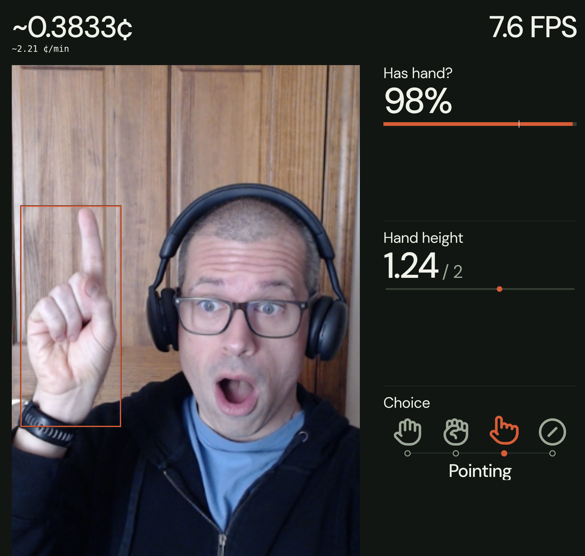

# Links

## Self-intro

**About Me:** Software engineering manager. Makerspace co-founder.

**What are we discussing?** "New type of AI model"

**Intended audience:** AI Users who are comfortable generating custom software, but not necessarily software engineers.

## Introduction

in 1860, William stanley Jevons saw a counterintuitive phenomena

**Jevons paradox:** 1860s efficient steam engines made coal use go UP, not DOWN.
A 20% increase in efficiency = 40% increase in travel.

Lower cost gave people more reasons to use steam.

**Today:** AI makes software cheaper to build. We keep finding more software to build.

## JEV

**Meet Jev.**

**Who:** TypeSafe AI. Named after William Stanley Jevons.

**The idea:** cheaper AI decisions unlock new applications.

**The trade-off:** highly efficient, with narrower capabilities.

## Problems

Good, fast, cheap trifecta

**More capable. Still rationed.**

**Progress:** benchmarks improve; more tasks become practical.

**The bottleneck:** cost and latency.

**The consequence:** useful workflows ignored because they are too expensive or too slow.

What if we could call an AI model hundreds of times per minute?

What if the answers came back in milliseconds?

## Enter Decision Models

**Decisions instead of sentences.**

**Analogy:** a Magic 8 Ball returns one preset answer, such as YES, without explaining it.

**Best fit:** language understanding matters; a written response adds no value.

**The payoff:** fast decisions at a tiny cost.

**Where it lives:** inside applications, such as support triage. No "Claude Code for Jev."

**Applications:** Insurance claim routing, document triage, spam detection, damage assesment, expense policy screening.

## Next: Live Demo

I said that JEV is cheaper and faster than an LLM.

So what are these never-before-seen use cases?

Let's use JEV to process images from my webcam in realtime.

**Next:** show frequent, inexpensive decisions in action.

## Demo

**START:** send camera frames to the TypeSafe API.

**POINT OUT:** the counter measures CENTS, not dollars.

**SHOW:** fist → open hand → pointing → remove hand.

**WATCH:** hand presence and gesture classification change.

**IF WRONG:** acknowledge the misclassification.

**LAND:** about 1.5 cents for this demo. Speed and cost enable repeated image analysis.

# Demo 2

**Find the overlooked story.**

**Who:** Jesse Waites, searching the Netherlands' national archives.

**Scale:** millions of historical documents screened with Jev.

**Discovery:** a forgotten meteorite report and other overlooked accounts.

**The payoff:** cheap screening finds promising material for closer investigation.

# Demo 3

Talk about funny Pokemon use case.

Then talk about serious stuff:

- Detect phishing
- route customer support tickets
- deciding which AI model should handles a request
- flagging risky commands before agent executes them
- grading language learners’ responses
- spotting damaged packages in photos
- categorizing financial transactions
- detecting prompt injection attempts
- prioritizing equipment maintenance reports
- checking closing documents for missing information
- deciding when a chatbot should hand off to a human
- selecting a robot’s next action from predefined options
- checking whether an AI agent actually completed its task

## The main show: JEV

Demo: <https://console.typesafe.ai/playground?share=shr_1c340dfbc12dcc240d9ba27fb89cfec2ff6>
Need coin.jpg in speaker notes for copy/pasting.
Usually called via API (show JSON version of snadbox)

1. State, 2. Questions, 3. Response

**Noul (or predicate in other vendors)**: Is This True?
**Choice**: Which Option Fits?
**Score**: Where Does This Fall on a Scale?
**Box**: Where Is It?

# Alternatives: OpenAI Decisions API

Visit <https://platform.openai.com/decisions> and re-do the coin example live.

**Jev isn't the only option.**
**OpenAI has a Decisions API:** shared input, questions, and typed answers.
**Familiar types:** predicate is the yes-or-no probability. Choice picks an option. Score rates ordered levels.
**The API is different:** No box type yet. Seems to be more intelligent than JEV, but slower and more expensive.

# Alternatives: Self-Hosted

I tried the local ones. They were just OK

**What:** 502 Korean reading questions from 12 TOPIK papers.

**Caveats:** Same passage and four choices; refusals counted wrong.

**My machine:** RTX 5070, 12 GB. Q8_0 in Ollama, all on GPU. Clef used 2K context; the others about 8K.

**The caveats:** public questions may be in training data. Network time included; warm-up excluded.

**My takeaway:** local was faster here, but less accurate. Privacy can still be a reason to run locally. Test your own workload.

# Conclusion

...

## Questions?

...
